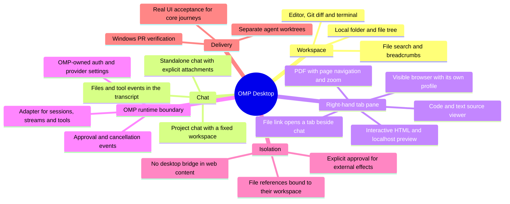

# OMP Desktop Design Map

This map describes the intended Windows app, not shipped features. OMP is the only agent runtime. The desktop is the workspace shell; the desktop framework and browser host are still open decisions.

## Decision order

1. Prove the installed OMP protocol and identify what the adapter can expose without duplicating OMP state ([`decisions/omp-runtime.md`](decisions/omp-runtime.md), [`contracts/omp-adapter.md`](contracts/omp-adapter.md)).
2. Pick a Windows host after checking whether it can render PDF and interactive HTML beside chat while isolating web content ([`decisions/browser-host.md`](decisions/browser-host.md)). Do not treat an embedded tab or a working directory as a sandbox.
3. Freeze the file-reference and preview contracts before splitting implementation ([`decisions/workspace-ux.md`](decisions/workspace-ux.md), [`contracts/file-reference-and-preview.md`](contracts/file-reference-and-preview.md)). Chat and the file tree should open the same tab for the same file in the same workspace. Test a restored chat after switching the visible project.
4. Build the [first click-to-preview journey](../README.md#core-interaction-open-files-from-chat) with the app running on Windows. Then expand to Git, terminal, browsing controls and other capabilities.
